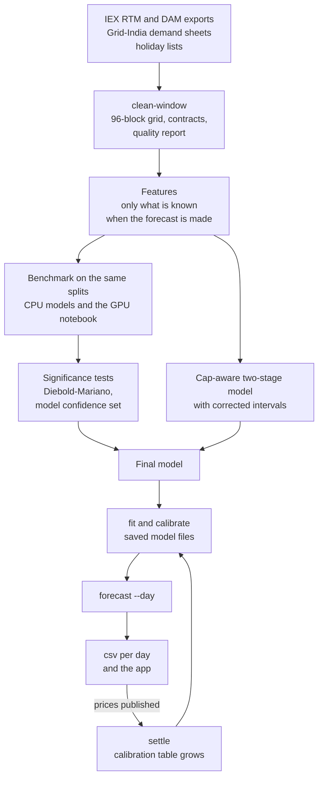

# RTM price forecast

Forecasting real-time market (RTM) electricity prices on the Indian Energy Exchange (IEX), one price for each
15-minute block of the day, from price, bid and demand data.

> Draft. The structure of the [report](docs/report.md) is written and its results sections are still to come.
> No price figures from the exchange are published here.

## Project stages

* **Phase 1 - Baseline.** A 2021 notebook that forecasts one test day (19 Jan 2021) with a random forest and
  XGBoost on 111 days of 15-minute data. It is kept in [`original/`](original/) as it was, except that its
  Colab link now points to this repository. Its forecasts are in `original/results/` and its data in
  `data/raw/price_data.csv`.
* **Phase 2 - Extension.** This repository. I rebuilt the work as a data pipeline and a fair benchmark, and I
  turned the best forecast into a command line and an app.

## What I did in Phase 2

1. **Data pipeline and audit.** Typed loaders with contracts, a full 96-block grid per day, and a data-quality
   report for every run (`reports/`). The steps run through DVC (`dvc.yaml`, `params.yaml`).
2. **Exploration.** Daily and weekly profiles, the gap between the day-ahead (DAM) and real-time prices,
   seasonality, volatility and the price cap (`notebooks/`).
3. **Check of Phase 1.** A faithful port with a test for every number the 2021 notebook printed, a rerun in a
   pinned 2020 environment (`repro2020/`), and each defect fixed on its own with its effect measured.
4. **Preprocessing and features.** Gap filling compared on hidden gaps, a variance-stabilising transform,
   holiday and calendar inputs, and only inputs that are known when the forecast is made, with tests that change
   future values and check that no input moves.
5. **Benchmark.** Naive forecasts, linear and statistical models, boosted trees, pretrained and neural time-series
   models, all on the same splits with rolling-origin evaluation, and significance tests (Diebold-Mariano, model
   confidence set).
6. **A forecast that knows the price cap.** A large share of the error comes from blocks that settle exactly at
   the exchange cap, so the final model first decides whether a block settles at the cap and then forecasts the
   price below it. Its prediction intervals are corrected with a margin learned on the days before.
7. **Engineering.** A package, a command line, an app, tests, continuous integration and a Docker image.

## The forecast tasks

* **Day ahead (main task).** Forecast the 96 RTM blocks of day D once the DAM results of day D are known, using
  the published prices of all earlier days.
* **Intraday.** Forecast a block 1, 2, 4 or 8 blocks after the latest known RTM block. The right lead depends on
  the exchange's gate-closure and result times, which I have not checked against the current rules.

Both tasks are scored on the same data: a 2025-26 window (1 Nov 2025 to 31 Oct 2026, 365 days, 35040 blocks)
with 268 training days, 30 validation days and 60 test days, plus five rolling folds of 30 days as a check. The
price cap is 10000 INR/MWh.

## Models compared

Naive forecasts (yesterday, last week, the DAM price, the latest known price), LEAR (lasso autoregressive model),
MSTL with exponential smoothing, LightGBM, CatBoost, the two Phase 1 models (random forest and XGBoost),
Chronos-Bolt and TimesFM (pretrained, no training on this data), N-HiTS and TFT (trained per fold), and the
two-stage cap-aware forecast with intervals. The pretrained and neural models run in a GPU notebook
([`kaggle/`](kaggle/README.md)); everything else runs on a CPU.

## How it fits together



## Repository layout

| Path | Contents |
|---|---|
| `src/rtm_forecast/` | the package: loaders, contracts, features, models, evaluation, significance tests, intervals, production fit, command line |
| `app/` | the Streamlit app |
| `config/`, `params.yaml` | holiday lists with their sources, all settings |
| `notebooks/` | executed notebooks: audit, exploration, Phase 1 check, preprocessing, model comparison |
| `scripts/` | the benchmark, significance, interval and model-card scripts for the 2025-26 window |
| `kaggle/` | the GPU notebook |
| `tests/` | the tests |
| `reports/`, `docs/figures/` | data-quality reports (counts only) and figures |
| `results/old_window/` | results on the 2020-21 data of Phase 1 |
| `original/`, `repro2020/` | Phase 1 as it was, and its rerun in the 2020 environment |
| `Dockerfile`, `docker-compose.yml` | the image for the command line and the app |

## Getting started

```
uv sync
uv run pytest
uv run dvc repro          # rebuilds the 2020-21 data tables and the quality report
```

## Forecasting a day

The final model is fitted on all published days, saved, and used for the next day. This needs the 2025-26 window
table, which is built from files that are not in this repository (see Data). Once it exists:

```
uv run rtm-forecast fit                       # fit on all published days
uv run rtm-forecast calibrate                 # once: forecasts of the last 60 days, used for the margins
uv run rtm-forecast forecast --day 2026-11-01 # point forecast and intervals, one csv per day
uv run rtm-forecast settle --day 2026-11-01   # on the next day, after its prices are published
uv run streamlit run app/streamlit_app.py     # the app: forecast of a day and the record of recent days
```

The app listens on this computer only. With Docker, the data folder is mounted and never copied into the image:

```
docker compose run --rm cli fit
docker compose up app                         # then open http://localhost:8501
```

## Data

The exchange files and the demand reports are not included, and I do not redistribute them. `docs/data_card.md`
names the sources and describes what I did with them. Check the terms of use of each source before you share a
file or a table of prices.

## Limits

See [`LIMITATIONS_AND_FUTURE_SCOPE.md`](LIMITATIONS_AND_FUTURE_SCOPE.md).

## Licence

The code of Phase 2 is under the MIT licence, see [`LICENSE`](LICENSE). The data are not covered by it: see
`docs/data_card.md`.
