# Forecasting real-time electricity prices on the Indian Energy Exchange

Report on Phase 2. The figures for the 2020-21 data come from the file that belongs to the 2021 project. For the
2025-26 window I publish scores and summary statistics computed from the exchange prices, not the prices or the
exchange files (see the [data card](data_card.md) for the terms of use and what I have not asked).

## Summary

**The question.** Once the day-ahead market (DAM) results of a day are known, how well can I forecast the real-time
market (RTM) price of each of its 96 blocks, compared with simple forecasts and with the two models of my 2021
notebook? I asked it on the 111 days of 2020-21 and on a window of 365 days from 1 Nov 2025 to 31 Oct 2026, where the
last 60 days (2 Sep to 31 Oct 2026) are the test days.

**The result.** On the 2020-21 data, five learning models beat the DAM price by 13 to 17 percent in mean absolute error, and I could
not separate them from one another on 21 days. On the 2025-26 window, almost half of the
test blocks (46.6 percent) settle at the exchange cap of 10000 INR/MWh. The tuned LightGBM and CatBoost models were
not significantly better than the same block yesterday (mean absolute error 800.1 and 812.6 against 863.2, p = 0.069
and 0.117), and the two Phase 1 models were worse than yesterday (955.8 and 987.4). The success criterion that I fixed
before tuning was not met by any of these models. I then built a two-stage model that first decides whether a block
settles at the cap. It has a mean absolute error of 736.0, which is 14.7 percent below yesterday's (p = 0.0021) and
significantly below both Phase 1 models, it is in the 90 percent model confidence set, and it is the best model in all
five rolling folds. On 22 days after the window (1 to 22 Nov 2026), forecast one day at a time as the daily commands do,
it scored 650.8 against 901.9 for yesterday.

**What it does not show.** I designed the two-stage model after the plain models had missed the criterion on the
test days, so those days are not a clean test for it, and the 22 new days are a short check, in a month when only
7.3 percent of blocks settled at the cap. One window of one market says little about other years. The tests have little
power with 60 days. I did not model costs or bidding, so a better forecast is not a trading result.

## 1. Question and setup

### 1.1 The problem

The real-time market (RTM) of the Indian Energy Exchange (IEX) sets a price for each 15-minute block of the day, 96
blocks per day. The day-ahead market (DAM) has already set its own prices for the same blocks when the RTM trades.
A forecast of the RTM price helps a buyer or seller decide how much to leave for the real-time market.

### 1.2 Data

The sources, the conventions, the cleaning rules and the quality counts are in the [data card](data_card.md). The
exchange files and the demand reports are not part of this repository.

### 1.3 Tasks

* **Day ahead (main task).** Forecast the 96 RTM blocks of day D once the DAM results of day D are known. Everything
  up to the end of day D - 1 is known, plus the DAM results of day D.
* **Intraday.** Forecast a block 1, 2, 4 or 8 blocks after the latest known RTM block. I have not tied these leads to
  the exchange's gate-closure and result times (see the limitations).

### 1.4 Evaluation protocol, fixed before any tuning

* **Splits.** The last days of the window are the test days. The 30 days before them are the validation days, and the
  days before those are the training days. Every choice of inputs and settings uses validation days only.
* **Rolling origin.** Each day is forecast by a model fitted on all earlier days with a published price (an expanding
  window). Final runs refit every day. While tuning, I refit every second validation day to save time.
* **Rolling folds as a check.** Five consecutive folds of 30 days, each forecast by models fitted on all days before it.
* **Measures.** Mean absolute error (MAE) and root mean squared error (RMSE) in INR/MWh; rMAE, the MAE divided by the
  MAE of the same block a day earlier; and for the price cap, precision, recall and F1 of calling a block at the cap.
  Blocks without a published price are left out.
* **Significance.** Diebold-Mariano tests on the daily mean absolute error (one-sided, with the Harvey-Leybourne-Newbold
  small-sample correction and a bootstrap interval for the mean daily difference), and the 90 percent model confidence
  set. The tables do not correct for the number of comparisons (section 2.7 gives a check with Holm's correction), and
  60 test days give the tests little power.
* **Success criterion, fixed before tuning.** A model succeeds if it beats the best simple forecast and both Phase 1
  models with a Diebold-Mariano p-value below 0.05 on the test days and is in the 90 percent model confidence set.
* **Tuning.** The same number of Optuna trials for each tuned model family (LEAR, LightGBM and CatBoost).

### 1.5 How the parts fit together

The flowchart in the [README](../README.md#how-it-fits-together) shows the path from the source files to the daily
forecast.

## 2. Steps

Each step has four parts: why I did it, what I did, what I found, and what I understand from it.

### 2.1 Data pipeline and audit

* **Why.** A forecast is only as good as the table behind it, and Phase 1 had no contract that its data had to meet.
* **What I did.** Typed loaders and contracts for the exchange exports and the demand sheets, a full grid of 96 blocks per
  day, and a data-quality report for each run. The steps run through DVC and read their settings from `params.yaml`.
* **What I found.** I audited two data sets. The counts are in the [data card](data_card.md) and in `reports/`.
  * **2020-21 data (Phase 1), 111 days, 10656 blocks.** Twelve RTM values are missing. They are always the three RTM
    columns together and always two blocks in a row: six gaps, each starting on an odd block. That is what a missing
    half-hour looks like, so I suspect that the RTM clears every 30 minutes, but I have not checked this against the
    exchange rules. No RTM price repeats for more than two blocks in a row, so I see no sign of a stuck price feed.

    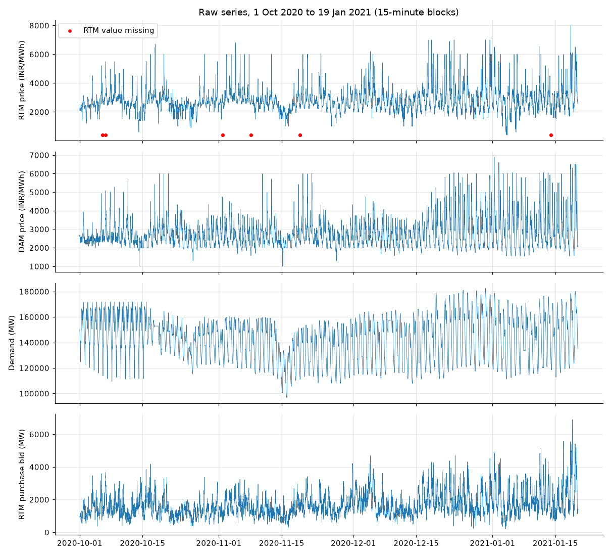

    *Figure 1. Raw series of the 2020-21 data in 15-minute blocks: RTM price, DAM price, demand and RTM purchase bid. Red dots mark the six gaps in the RTM price.*
  * The two bid columns hold values from about 199 to 26787. That is too large and too regular for prices, so I read
    them as volumes in MW. My first draft of the data contract treated them as prices and failed on the real file,
    which is how I noticed.
  * Demand is the weak column. It has 16 runs of four or more identical values (359 rows, the longest 87 blocks, about
    22 hours), and three pairs of days share exactly the same 96 values. From 1 to 15 October the daily maximum stays
    between 171594 and 171833 MW, which measured demand does not usually do. I cannot tell the cause from the file.

    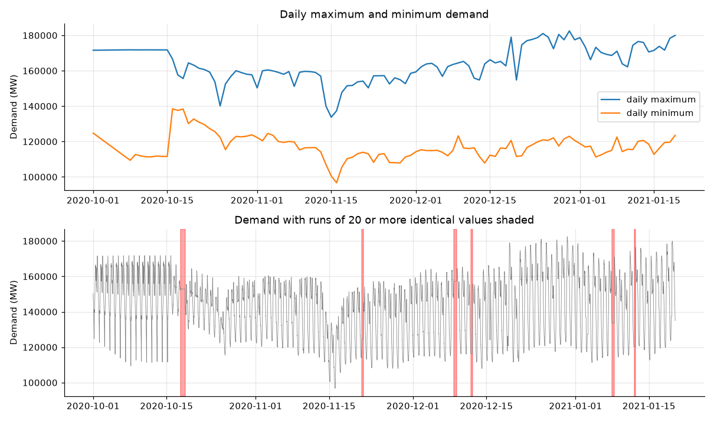

    *Figure 2. Top: daily maximum and minimum demand. Bottom: demand, with runs of 20 or more identical values shaded. I treat runs of four or more as unreliable, so the shading shows only the longest.*
  * **2025-26 window, 365 days, 35040 blocks.** RTM has 14 blocks missing, in two runs of consecutive blocks. DAM has
    none missing. Demand has 104 blocks missing and 6 flagged as suspect. The demand sheet changed layout twice during
    the year, so there are three layouts, with storage columns in the later two, and the demand figure counts storage
    load from mid-2026.
  * **What the audit made me change.** The data contract has separate bounds for prices, bids and demand. A block where
    every exchange value is zero is set to missing. A demand reading that cannot be physical is set to missing, and one
    that looks wrong but passes the rules is flagged and kept. The models use demand without storage load, so that it
    means the same thing all year. The assumptions behind these rules are listed in the data card and in the limitations.
* **What I understand.** A model is only as good as the table behind it, and here the table had problems that I could
  see only because the checks failed or the values looked wrong. Prices are nearly complete in both data sets. Demand
  is not, and its definition changes. I keep every row, mark the doubtful ones and test the models with and without
  demand, instead of repairing values by guessing. Several of the choices (zero everywhere means missing, a reading
  that cannot be physical, the day a demand report describes) are assumptions that I could not confirm from the files.

### 2.2 Exploration

* **Why.** To see which patterns a model can use, and which breaks it must live with.
* **What I did.** Daily and weekly profiles, the gap between the DAM and RTM prices, autocorrelation, a seasonal
  decomposition, volatility, the relation to demand and the spikes, on the 2020-21 data in notebook 02. I did the same
  kind of exploration on the 2025-26 window, including the price cap.
* **What I found.** The figures below are from the 2020-21 data, except the last item, which gives summary figures of
  the 2025-26 window.
  * **Daily and weekly shape.** Prices have two peaks a day, in the late morning and the early evening. On weekdays the
    lowest average RTM price is in block 16 (2083 INR/MWh) and the highest in block 74 (4144). Only Sunday is a low
    day: its mean RTM price is 2550, while Saturday (2891) is close to the weekdays (2784 to 2963). My first notebook
    flagged Saturday and Sunday together, which hides this.

    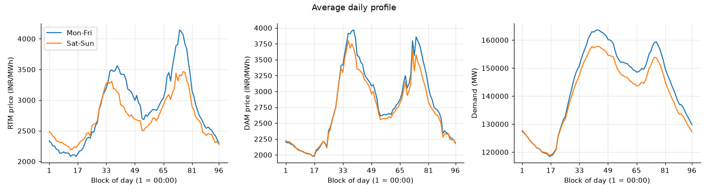

    *Figure 3. Average RTM price, DAM price and demand by block of the day, weekdays against weekends. Saturday and Sunday are drawn together here, which hides that only Sunday is low.*
  * **Levels move.** The mean RTM price rises from 2691 in October to 2981 in January, and its standard deviation
    from 664 to 1030. The mean daily standard deviation is 528 in the first half of the window and 786 in the second.
    The last day, 19 January 2021, which my first notebook used as its single test day, has the highest mean price of
    the 111 days (3990) and the third highest daily standard deviation (1476).

    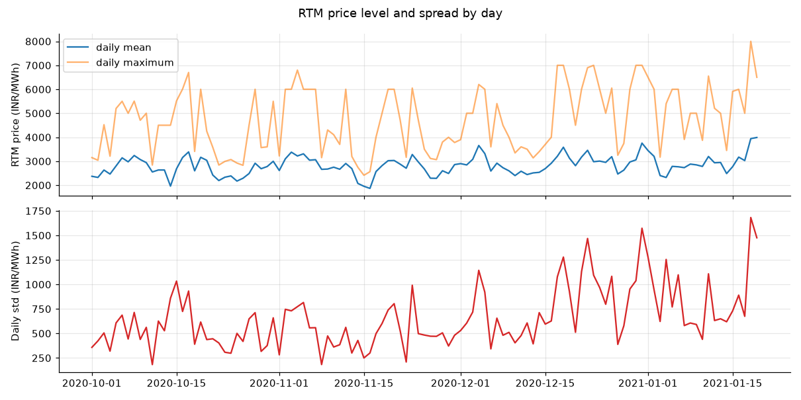

    *Figure 4. Daily mean and maximum of the RTM price (top) and its daily standard deviation (bottom).*
  * **RTM against DAM.** RTM is above DAM in 59.0 percent of blocks. The mean gap is 48 INR/MWh, the median 83 and
    the standard deviation 594, so the gap is small on average and large in single blocks. The two prices have a
    correlation of 0.721. In January the RTM price is on average below the DAM price (gap -103), in the other months
    above it.

    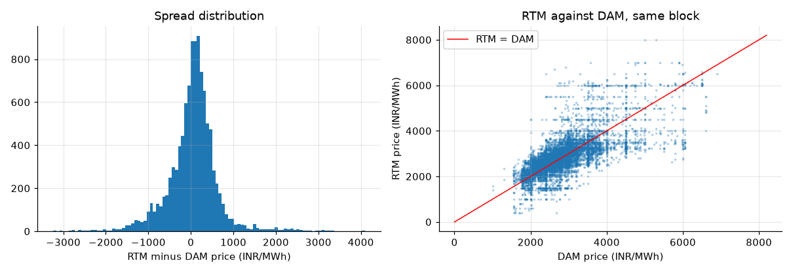

    *Figure 5. Left: RTM minus DAM price in the same block. Right: RTM against DAM price, with the line RTM = DAM. The horizontal rows of points are round RTM values such as 6000.*
  * **Memory.** The autocorrelation is 0.936 at 15 minutes, 0.777 at one hour and 0.561 at two hours, then rises again
    to 0.660 at one day and is 0.409 at one week. In the partial autocorrelation only lag 1 is large. A decomposition
    into trend, daily pattern and remainder gives a daily seasonal strength of 0.689 and a trend strength of 0.454.

    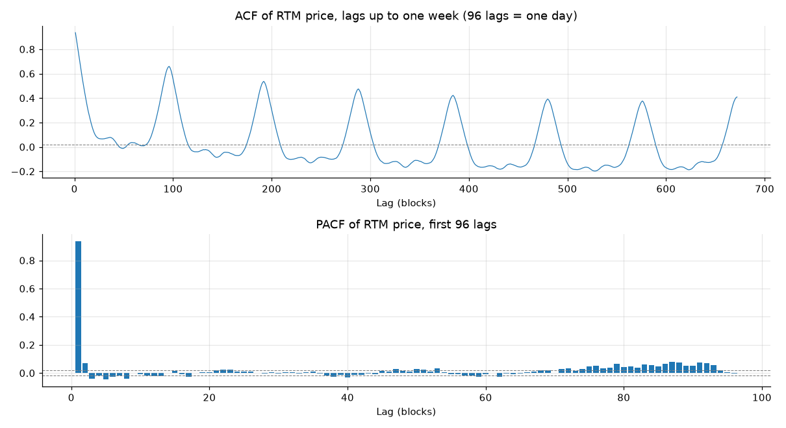

    *Figure 6. Autocorrelation of the RTM price up to one week (top) and partial autocorrelation over the first day (bottom), in blocks.*

    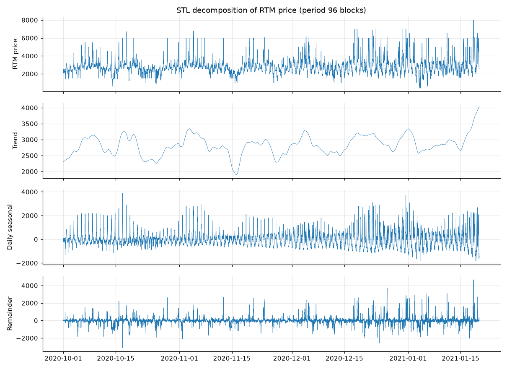

    *Figure 7. Decomposition of the RTM price into trend, daily seasonal part and remainder (period 96 blocks).*
  * **Demand.** After I leave out the first 15 days and the repeated-value runs, 8857 of the 10656 rows remain. Demand
    has a correlation of 0.688 with the RTM price and 0.784 with the DAM price. By hour of day the correlation with
    the RTM price is strongest at hour 9 (0.69) and weakest at hour 22 (0.24).

    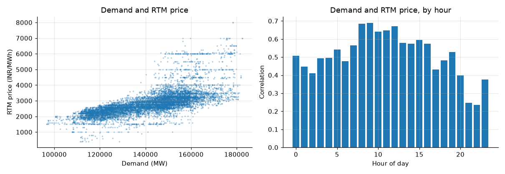

    *Figure 8. Left: RTM price against demand. Right: correlation of the two by hour of day.*
  * **Spikes.** 268 blocks lie above 5292 INR/MWh (the mean plus three standard deviations), on 42 days. Most fall in
    hours 8 to 10 (92 blocks) and hours 17 to 19 (142 blocks). December has 106 of them and January 96, although
    January has only 19 days in the data.
  * **2025-26 window, including the price cap.** Of the 35026 blocks with a published price in the 365 days, 19.8
    percent (6930) settle exactly at the cap of 10000 INR/MWh, and at least one block does so on 288 of the 365 days. The
    share changes a lot over the year: 5.4 percent in November 2025, 5.4 to 10.6 percent from December to March, 26.8
    percent in April, 18.0 to 21.8 percent from May to August, then 55.1 percent in September and 38.5 percent in
    October. On 52 days at least half of the 96 blocks are at the cap. The mean RTM price rises from 3136 INR/MWh in
    November 2025 to 6906 in September 2026, and over the window it is 4417 (median 3300). In the test days (2 Sep to 31
    Oct) 46.6 percent of the blocks are at the cap and the mean is 6321. The DAM price is at the cap in 24.9 percent of
    the blocks. Unlike in 2020-21, the RTM price is below the DAM price on average (mean gap -408, RTM above DAM in
    38.2 percent of blocks), and the correlation of the two is 0.841. The RTM price is 0 in 21 blocks.
    Because the cap share is low in the first months and high in the last two, the training days are less like the test
    days than in a calmer year.
* **What I understand.** The market has a clear daily shape, a Sunday dip, rising volatility and spikes in two daily
  windows. The DAM price of the same block and yesterday's RTM price at the same block are the most informative
  inputs I have, and a good model has to do more than copy either. Rising volatility means that a test period near
  the end of a window is harder than one near the start, and one test day, especially 19 January, is not a fair test.
  That is why step 2.5 evaluates over many days. These findings come from 111 days of one autumn and winter, so I do
  not assume that they hold for the 2025-26 window.

### 2.3 Check of Phase 1

* **Why.** Before I compare with Phase 1, I need to know what it computed.
* **What I did.** A faithful port with a test for every number the 2021 notebook printed, a rerun in a pinned 2020
  environment, and each defect fixed on its own so that I could measure its effect. Naive forecasts on the same day.
* **What I found.** The table of defects, with the effect of each fix, is in Appendix A. The scores below are on the
  one test day of Phase 1 (19 Jan 2021), in INR/MWh.
  * My 2021 forecasts, read from the saved files, score MAE 708.77 and MAPE 15.32 for the random forest and MAE 757.87
    and MAPE 16.17 for XGBoost. The 2021 README called this about 85 percent accuracy. As 100 minus MAPE the files give
    84.68 and 83.83.
  * Of three forecasts that use no model, two score well. The same block yesterday (MAE 431.57, MAPE 10.98) is better
    than both models on both measures, and it stays better in every variant of the inputs that I tried. The DAM price
    (MAE 597.38, MAPE 15.89) has a lower MAE than both models and a lower MAPE than XGBoost. The same block last week
    does not (MAE 1088.43, MAPE 21.83).
  * Rerun unchanged in the 2021 environment, the data preparation and the XGBoost search and evaluation print the same
    values as in 2021, and the XGBoost forecasts are equal to the saved ones. The 12 differing values all belong to the
    random forest, which had no seed.
  * Reading the dates day first changes the XGBoost MAPE by about two points (16.17 to 14.10). That is more than the
    gap between my two models in 2021 (15.32 against 16.17).

    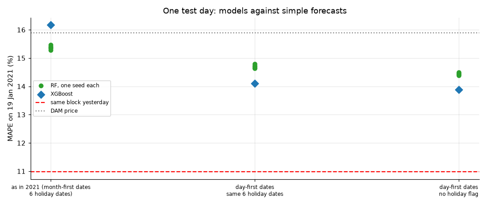

    *Figure 9. MAPE on the test day of Phase 1 for XGBoost (diamond) and the random forest (one dot per seed), under three versions of the dates and holidays, against two forecasts that use no model.*
* **What I understand.** On this one day none of my models beat yesterday's price, so the 2021 claim of about 85
  percent accuracy says little: a forecast that copies the day before does better on the same measure. The defects
  change the scores by more than the gap I reported between the models. With the dates read correctly XGBoost scores a
  lower MAPE than the random forest (14.10 against 14.70), the opposite of 2021. One day cannot rank models either way,
  so I draw no conclusion about which model is better from it. What I take from this step is the method: fix the date handling, put the simple
  forecasts next to every model as baselines, and evaluate over many days. Steps 2.4 and 2.5 do this.

### 2.4 Preprocessing and features

* **Why.** A model must see only what is known when the forecast is made.
* **What I did.** Gap filling compared on hidden gaps, a variance-stabilising transform compared with raw prices,
  calendar and holiday inputs, lags of price, demand, wind and solar, and tests that change future values and check
  that no input moves.
* **What I found.** The figures are from the 2020-21 data in notebook 04. The 2025-26 table is built by the same
  code, with the holiday lists of 2025 and 2026.
  * **Filling gaps.** My first notebook filled the 12 missing RTM values with the previous block. I hid 1500 known
    values at a time, filled them and measured the error. For gaps of two blocks, a straight line gives a mean error
    of 163.28 against 215.85 for the previous block, and for gaps of eight blocks 230.57 against 360.53. Yesterday's
    value in the same block is clearly worse (426.71 and 423.68). Each method sees only values up to the end of the day
    that holds the gap, because a forecast for tomorrow may use today's filled values but must not look into tomorrow.

    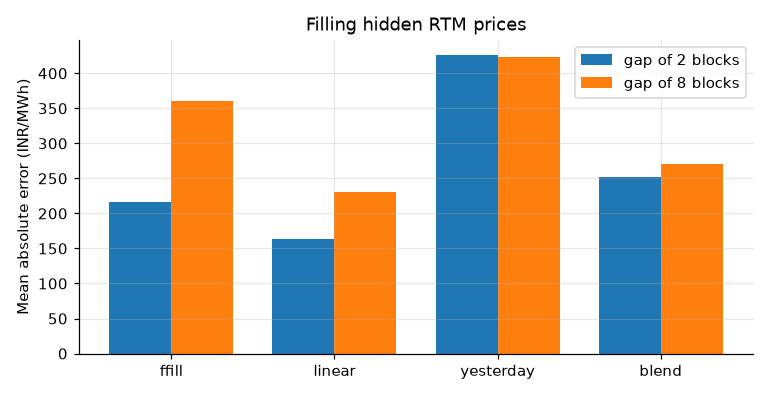

    *Figure 10. Mean absolute error of four ways to fill hidden RTM prices, for gaps of two and eight blocks (ffill is the previous block, blend is a mix of methods).*
  * **The transform.** The prices have a long right tail (skew 1.621 over all days). The arcsinh transform is close to
    a logarithm for these prices. I compared scales on the first 90 days only, so that the choice does not look at
    later days. A scale of 1000 brings the skew on those days from 1.532 to 0.041, the plain logarithm gives -0.386,
    and every scale up to 1000 removes most of the skew. I keep arcsinh because it also works for zero and negative
    prices. The transform can be undone exactly (largest round-trip error 1.8e-12). Whether it helps a model is a
    question for step 2.5.

    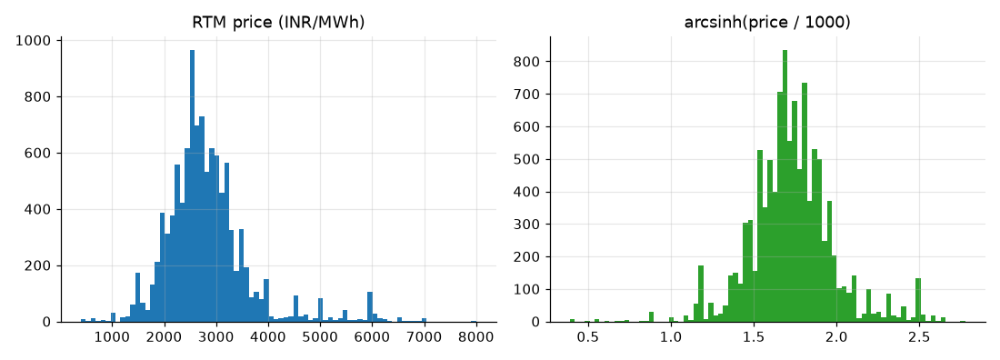

    *Figure 11. RTM price (left) and its arcsinh transform with scale 1000 (right).*
  * **Holidays.** The first notebook's list left out 30 November (Guru Nanak's Birthday), included 31 December, which
    is not on the central government list, and labelled 30 October "Good Friday", although that day is Milad-un-Nabi
    and Good Friday was on 10 April. The new lists come from the Department of Personnel and Training. I read the
    memoranda for 2025 and 2026 in full. For 2020 I used a reproduction of the memorandum and did not open the
    original. The lists cover central government holidays only.
  * **Demand.** 2087 demand rows are not trusted: the first 15 days (1440 rows), runs of four or more identical values
    (359 rows) and the second day of each pair of identical days (288 rows). The feature builder sets them to missing,
    so that a model never sees them, unless I ask for the published values.
  * **The table.** One row per day and block, from 8 October 2020 to 19 January 2021 (9984 rows), with the first seven
    days used only to build lags. The inputs are the DAM price and volumes of the forecast day and simple summaries of
    that day's DAM prices, the RTM price and bids of the previous day and of the same day a week earlier, the previous
    day's mean and spread of RTM prices, yesterday's RTM minus DAM price, demand a day and a week earlier, and the
    block, the day of the week and a holiday flag. Eight rows have no published target and are kept with a flag, so
    that models do not train on them.
  * **First look at the inputs.** By rank correlation with the price, the DAM price of the same block (0.772) and
    yesterday's RTM price (0.764) are the strongest, followed by demand a day earlier (0.730) and the DAM purchase
    volume (0.726). The DAM selling volume has the strongest negative one, about -0.7. This is not a model.

    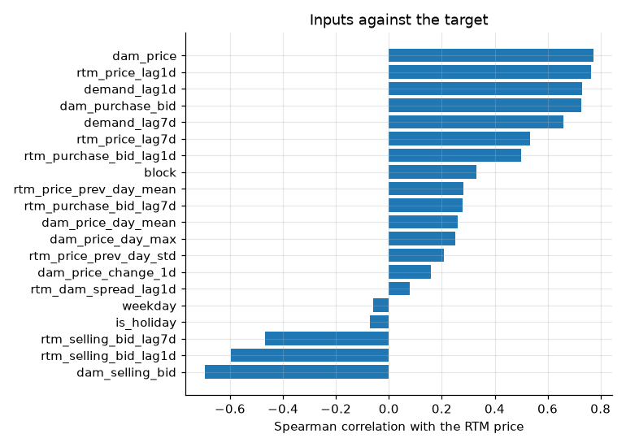

    *Figure 12. Rank correlation of each input with the RTM price.*
  * **No look-ahead.** The tests scramble everything a forecaster could not yet know (RTM and demand from the forecast
    day on, DAM after it) and check that the inputs of the forecast day do not change, for three days. They also check
    that a gap fill never looks into the next day, and I confirmed that these tests fail when the fill does look ahead.
* **What I understand.** Straight-line filling beats the previous-block fill, so the first notebook's way of handling
  gaps was not the best one. The scale of the transform matters little, and I keep arcsinh for its behaviour at zero.
  Demand needs care: it is the least reliable input and its definition changes, so I compare models with and without
  it in step 2.5. The correlations only say which inputs are worth trying. The tests are the evidence for the claim
  that every input is known when the forecast is made, but they cover three days of the 2020-21 table and, for the
  2025-26 inputs, a changed-day test on a synthetic window, not every day. I treat that claim as checked, not proved.

### 2.5 Benchmark and tuning

* **Why.** To compare simple and complex models on the same footing.
* **What I did.** Naive forecasts, LEAR, MSTL with exponential smoothing, LightGBM, CatBoost, the two Phase 1 models,
  Chronos-Bolt and TimesFM (pretrained), and N-HiTS and TFT (trained per fold), on the same splits. On the 2020-21 data
  I ran nine of them: three naive forecasts (yesterday, last week, the DAM price), LEAR, MSTL, LightGBM, CatBoost and the
  two Phase 1 models (refitted under this protocol). The 104 forecast days are split in time: the 21 last days (30 December 2020 to 19
  January 2021) are the test days, the 14 days before them (16 to 29 December) are validation days, and the rest are
  training days. Every choice was made on the validation days, and the test days were forecast once, after all choices
  were fixed. Each model is refitted every day on all earlier days with a published price.
* **What I found.**
  * **2020-21 data, 21 test days (notebook 05).** Prices are in INR/MWh, and rMAE is the MAE divided by that of the
    same block last week.
  * **Choices on the validation days.** I compared settings with LightGBM at fixed parameters, three seeds each. The
    arcsinh transform lowered the mean error from 411.40 to 395.01. Leaving the demand inputs out gave 389.39, against
    395.01 with them and 395.14 with demand as published. The seed ranges overlap, so this is a judgement: demand does
    not clearly help in this window, and its early values are unreliable, so I dropped it there. Removing the calendar
    group hurt most (451.83), then the day-ahead inputs (423.60) and the RTM lags (407.51).
  * **Tuning.** LightGBM, CatBoost and LEAR got 30 Optuna trials each on the validation days. The best trial scored
    377.40 (LightGBM), 373.29 (CatBoost) and 401.02 (LEAR). The median trial of the two tree models scored 383.72 and
    383.33, so the search gained about 6 to 10 over a typical setting. The best LEAR penalty (0.0001) is tiny, which
    means almost no shrinkage.

    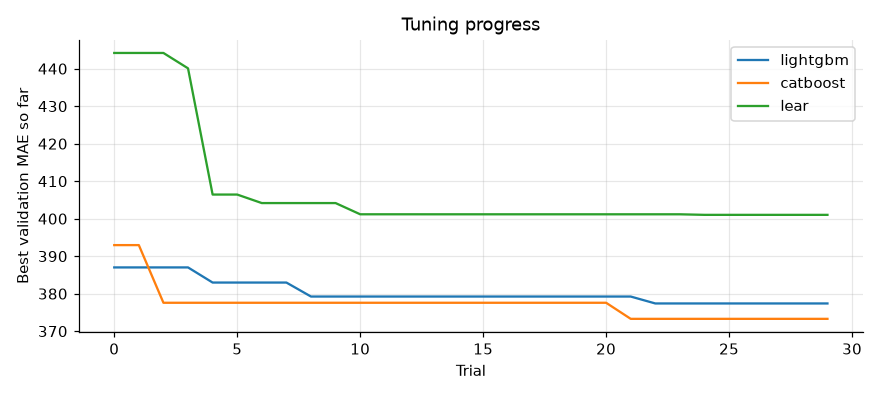

    *Figure 13. Best validation MAE so far, by trial.*
  * **Scores on the test days (Table O1).** The validation scores are optimistic, because the models were tuned on
    those days, so I do not use them to rank the models.

    | Model | MAE | RMSE | MAPE | rMAE |
    |---|---|---|---|---|
    | LEAR | 412.43 | 644.94 | 15.58 | 0.674 |
    | CatBoost | 418.20 | 674.08 | 15.14 | 0.683 |
    | Random forest (Phase 1) | 423.79 | 655.07 | 16.00 | 0.692 |
    | XGBoost (Phase 1) | 434.60 | 669.63 | 16.31 | 0.710 |
    | LightGBM | 434.78 | 662.76 | 16.21 | 0.710 |
    | DAM price | 499.08 | 725.33 | 18.58 | 0.815 |
    | Same block yesterday | 522.09 | 818.42 | 19.20 | 0.853 |
    | MSTL with exponential smoothing | 581.74 | 837.53 | 19.67 | 0.950 |
    | Same block last week | 612.13 | 956.71 | 21.58 | 1.000 |

    The best model, LEAR, is 2.68 percent below the Phase 1 random forest. The ranking of the top models changed between
    the validation and test days: LightGBM went from second to fifth and LEAR from fifth to first.
  * **Significance (Table O2).** One-sided Diebold-Mariano tests on the daily mean absolute error. The best simple
    forecast on the test days is the DAM price. The table gives each model's mean daily difference from it.

    | Model | Mean daily MAE difference | 95% interval | DM p-value | Days better (of 21) |
    |---|---|---|---|---|
    | LEAR | -86.78 | -135.72 to -35.88 | 0.002 | 15 |
    | CatBoost | -81.00 | -136.58 to -20.71 | 0.008 | 14 |
    | Random forest (Phase 1) | -75.35 | -120.43 to -24.55 | 0.004 | 16 |
    | XGBoost (Phase 1) | -64.56 | -109.44 to -15.62 | 0.010 | 16 |
    | LightGBM | -64.39 | -112.88 to -11.00 | 0.014 | 16 |

    No learning model is clearly better than another. Among the five, the smallest p-values are CatBoost against LightGBM
    (0.03), LEAR against LightGBM (0.06) and LEAR against XGBoost (0.06), and with 36 pairs compared a single p of 0.03
    is weak evidence. The success criterion that I set before tuning is not met on this window: the best model, LEAR,
    beats the Phase 1 random forest with p = 0.24 and the Phase 1 XGBoost with p = 0.06.

    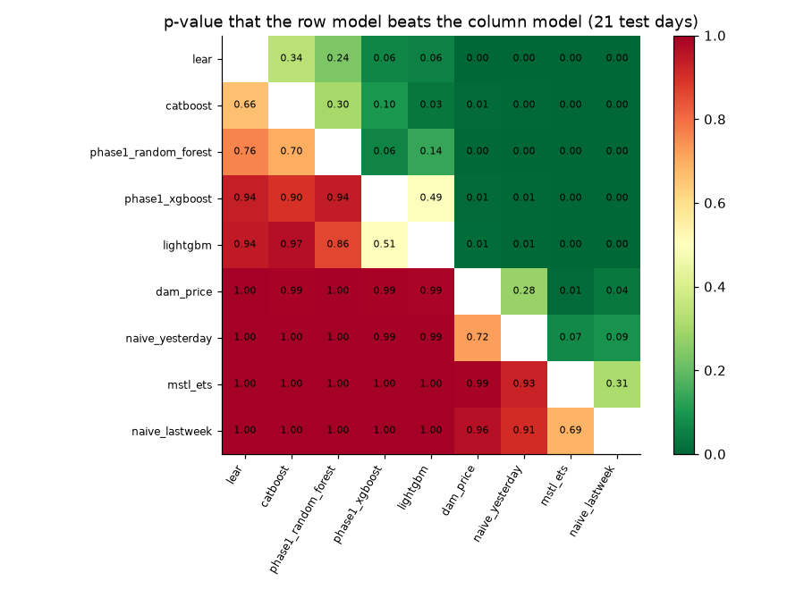

    *Figure 14. One-sided p-value that the row model has a lower daily error than the column model, on the 21 test
    days. Green is small, red is large.*
  * **Errors by day and by time of day.** All models move together from day to day, and two days stand out, 31 December
    and 18 January. On 18 January the DAM price (575) beats the three learning models in the figure (767 to 858), and
    yesterday's price is far worse (1046). Every model is worst between 06:00 and 12:00 (LEAR 594, CatBoost 618,
    LightGBM 614), where the DAM price is much worse (806). In the afternoon the DAM price (427) is about as good as
    LEAR (401).

    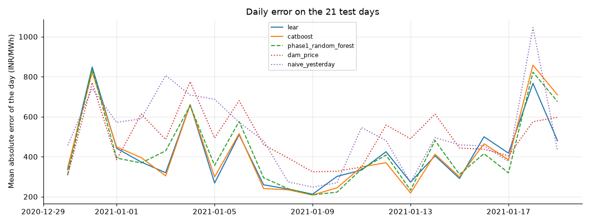

    *Figure 15. Mean absolute error by test day for LEAR, CatBoost, the Phase 1 random forest, the DAM price and
    yesterday's price.*
  * **The Phase 1 test day under this protocol.** On 19 January 2021, the day my first notebook used alone, no model
    beats yesterday's price on MAE (431.57). LEAR is the closest (480.16) and has a slightly lower MAPE (10.64 against
    10.98). The other models have MAEs from 640.53 to 708.76.
  * **2025-26 window.** The training days are 1 Nov 2025 to 2 Aug 2026 (268 days), the validation days 3 Aug to 1 Sep
    (30 days) and the test days 2 Sep to 31 Oct (60 days). Every model is refitted each day on the days before it. The
    final model of section 2.7 is in the tables, because it came out of this comparison; the rest of this section
    reads the other models. The pretrained models (TimesFM and Chronos-Bolt) and the neural models (N-HiTS and TFT)
    ran in the notebook `kaggle/foundation_models.ipynb`, as set up there, and I did not tune them on this window.
    Units are INR/MWh; rMAE is the MAE divided by the MAE of the same block yesterday; the cap F1 is the F1 of calling
    a block at the cap.

    *Table R1. Day-ahead scores on the 60 test days, best MAE first.*

    | Model | MAE | RMSE | rMAE | Cap F1 |
    |---|---|---|---|---|
    | Final model (two-stage, median of the mixture) | 736.0 | 1644.4 | 0.853 | 0.923 |
    | Two-stage, hard cap call | 745.1 | 1688.5 | 0.863 | 0.923 |
    | LightGBM | 800.1 | 1547.9 | 0.927 | 0.894 |
    | CatBoost | 812.6 | 1535.4 | 0.941 | 0.887 |
    | Same block yesterday | 863.2 | 1776.0 | 1.0 | 0.909 |
    | TimesFM | 954.1 | 1662.2 | 1.105 | 0.872 |
    | Chronos-Bolt | 955.2 | 1674.7 | 1.107 | 0.844 |
    | XGBoost (Phase 1) | 955.8 | 1591.1 | 1.107 | 0.801 |
    | Random forest (Phase 1) | 987.4 | 1580.9 | 1.144 | 0.753 |
    | LEAR | 1037.0 | 1559.8 | 1.201 | 0.742 |
    | DAM price | 1060.6 | 2164.9 | 1.229 | 0.879 |
    | N-HiTS | 1232.6 | 1814.6 | 1.428 | 0.735 |
    | MSTL-ETS | 1387.8 | 1934.0 | 1.608 | 0.726 |
    | TFT | 1394.0 | 2208.1 | 1.615 | 0.699 |
    | Same block last week | 1929.0 | 3179.2 | 2.235 | 0.745 |

    * LightGBM (800.1) and CatBoost (812.6) have the lowest MAE of the plain models, 7.3 and 5.9 percent below the same
      block yesterday (863.2). Both Phase 1 models are worse than yesterday (rMAE 1.107 for XGBoost and 1.144 for the
      random forest), and so is the DAM price (1.229).
    * The ranking by RMSE differs from the ranking by MAE. CatBoost (1535.4) and LightGBM (1547.9) have a lower RMSE
      than the final model (1644.4), which forecasts the median and so is closer on most blocks and further off on a few
      large misses.
    * LEAR, the best model of 2020-21, is in the lower half here (rMAE 1.201). TimesFM and Chronos-Bolt, as run here,
      are about 10 percent worse than yesterday, and N-HiTS and TFT are worse than that.

    *Table R2. The same on the 30 validation days. The tuned models (LEAR, LightGBM, CatBoost) were tuned on these
    days, so their scores are optimistic.*

    | Model | MAE | RMSE | rMAE | Cap F1 |
    |---|---|---|---|---|
    | Final model (two-stage, median of the mixture) | 992.9 | 1749.1 | 0.772 | 0.791 |
    | Two-stage, hard cap call | 1017.4 | 1848.7 | 0.791 | 0.791 |
    | CatBoost | 1054.2 | 1685.6 | 0.82 | 0.663 |
    | LightGBM | 1073.1 | 1711.2 | 0.834 | 0.669 |
    | N-HiTS | 1148.5 | 1656.8 | 0.893 | 0.533 |
    | LEAR | 1170.2 | 1674.8 | 0.91 | 0.327 |
    | DAM price | 1179.2 | 2067.4 | 0.917 | 0.764 |
    | XGBoost (Phase 1) | 1180.2 | 1699.7 | 0.918 | 0.369 |
    | Random forest (Phase 1) | 1189.8 | 1698.4 | 0.925 | 0.313 |
    | Chronos-Bolt | 1241.4 | 1825.3 | 0.965 | 0.474 |
    | TimesFM | 1243.5 | 1847.3 | 0.967 | 0.475 |
    | Same block yesterday | 1286.2 | 2122.5 | 1.0 | 0.707 |
    | TFT | 1296.2 | 1931.3 | 1.008 | 0.482 |
    | Same block last week | 1747.9 | 2681.9 | 1.359 | 0.596 |
    | MSTL-ETS | 1891.4 | 2390.9 | 1.471 | 0.503 |

    On the validation days yesterday's price is among the weakest forecasts (rMAE 1.000 against 0.82 and 0.83 for
    CatBoost and LightGBM). The test days reverse that for the plain models, which is the mismatch between validation
    and test that I saw in 2020-21 too.

    *Table R3. MAE in each of the five rolling folds of 30 days each (4 Jun to 3 Jul, 4 Jul to 2 Aug, 3 Aug to 1 Sep,
    2 Sep to 1 Oct and 2 Oct to 31 Oct). Fold 3 is the validation period and folds 4 and 5 are the test days.*

    | Model | Fold 1 | Fold 2 | Fold 3 | Fold 4 | Fold 5 |
    |---|---|---|---|---|---|
    | Final model (two-stage, median of the mixture) | 1249 | 965 | 993 | 735 | 737 |
    | Two-stage, hard cap call | 1281 | 999 | 1017 | 752 | 739 |
    | LightGBM | 1306 | 1014 | 1073 | 815 | 785 |
    | CatBoost | 1268 | 995 | 1054 | 818 | 807 |
    | Same block yesterday | 1399 | 1183 | 1286 | 803 | 923 |
    | TimesFM | 1377 | 1342 | 1243 | 969 | 939 |
    | Chronos-Bolt | 1325 | 1233 | 1241 | 986 | 925 |
    | XGBoost (Phase 1) | 1338 | 1101 | 1180 | 955 | 956 |
    | Random forest (Phase 1) | 1339 | 1113 | 1190 | 996 | 978 |
    | LEAR | 1317 | 1146 | 1170 | 1050 | 1024 |
    | DAM price | 1503 | 1035 | 1179 | 898 | 1223 |
    | N-HiTS | 1576 | 1262 | 1149 | 1398 | 1067 |
    | MSTL-ETS | 1830 | 1858 | 1891 | 1478 | 1297 |
    | TFT | 1442 | 1222 | 1296 | 1413 | 1375 |
    | Same block last week | 1751 | 2241 | 1748 | 1963 | 1895 |

    The final model has the lowest MAE in all five folds. LightGBM and CatBoost are below yesterday's price in four of
    the five folds and above it in fold 4 (815 and 818 against 803).

    *Table R4. Intraday MAE on the test days at the leads 1, 2, 4 and 8 blocks, best at lead 1 first. The last known
    price is the latest published RTM price at that lead. Yesterday's price and the DAM price do not depend on the
    lead.*

    | Model | Lead 1 | Lead 2 | Lead 4 | Lead 8 |
    |---|---|---|---|---|
    | Final model (two-stage, median of the mixture) | 268.6 | 399.6 | 515.4 | 620.4 |
    | Two-stage, hard cap call | 275.1 | 404.1 | 518.9 | 625.9 |
    | LightGBM | 307.1 | 462.1 | 610.3 | 727.7 |
    | Last known price | 320.9 | 559.0 | 955.2 | 1617.8 |
    | TimesFM | 322.9 | 496.3 | 663.3 | 782.8 |
    | CatBoost | 324.9 | 469.1 | 602.9 | 703.2 |
    | Last known price moved by the DAM change | 363.3 | 577.6 | 812.1 | 973.5 |
    | Chronos-Bolt | 373.1 | 511.9 | 668.7 | 774.7 |
    | LEAR | 419.8 | 638.4 | 851.6 | 993.3 |
    | N-HiTS | 454.3 | 629.2 | 806.4 | 1015.8 |
    | TFT | 568.4 | 721.4 | 938.5 | 1137.5 |
    | Same block yesterday | 863.0 | 863.2 | 863.3 | 863.2 |
    | DAM price | 1061.1 | 1061.2 | 1061.0 | 1060.6 |

    The final model has the lowest MAE at every lead (268.6 at lead 1 and 620.4 at lead 8). The last known price
    degrades quickly as the lead grows (320.9 at lead 1, 1617.8 at lead 8) and is worse than yesterday's price at
    leads 4 and 8. The leads are in blocks and are not tied to the gate-closure times of the exchange.
* **What I understand.**
  * **From the 2020-21 data.** The learning models are about 17 percent better than the DAM price (LEAR 412.43 against
    499.08), and the tests support that gain (p from 0.002 to 0.014 against the best simple forecast). They cannot be
    separated from each other on 21 days, and the Phase 1 random forest, refitted daily on corrected inputs, is within 3
    percent of the best. So the progress over my first notebook comes mostly from evaluating properly, fixing the dates
    and filling gaps better, not from a more complicated model. That a plain lasso model does as well as the boosted
    trees suggests that, once the day-ahead price and volumes are known, the relationship is simple. The mismatch between
    validation and test rankings is a warning against reading a ranking from a short period. It is also why the same
    comparison runs on a year of newer data, with neural and pretrained models added.
  * **From the 2025-26 window.** The ranking of 2020-21 does not carry over. LEAR, the best model there, and the Phase 1
    models are worse than the same block yesterday here, and the plain boosted trees are only a little better. A
    reason may be the cap: almost half of the test blocks settle at 10000, up to 72 blocks of a day do so, and
    yesterday's price is a better forecast of those blocks (error 383.2) than LightGBM (416.9), which averages and is
    pulled below the cap. Models that predict the cap (section 2.7) are where the gain is. The pretrained and neural
    models, as I ran them, did not beat yesterday either, so I treat the result as one of this setup and not as a
    statement about those model families. The plain models are 17 to 18 percent better than yesterday's price on the
    validation days and 6 to 7 percent better on the test days, which is why I read the five folds and not one period.

### 2.6 Significance, uncertainty and errors

* **Why.** A lower error on 60 days can be luck.
* **What I did.** Diebold-Mariano tests against the best simple forecast and both Phase 1 models, bootstrap intervals,
  the 90 percent model confidence set, and an error analysis by block, weekday and price level.
* **What I found.** On the 60 test days of the 2025-26 window. A negative difference means a lower error than the
  reference.

  *Table R5. Mean daily MAE difference from the same block yesterday, its 95 percent bootstrap interval, and the
  one-sided Diebold-Mariano p-values that the model is better than yesterday, than the Phase 1 random forest and than
  the Phase 1 XGBoost.*

  | Model | Mean daily MAE difference from yesterday | 95% interval | p vs yesterday | p vs random forest (Phase 1) | p vs XGBoost (Phase 1) |
  |---|---|---|---|---|---|
  | Final model (two-stage, median of the mixture) | -127.2 | -213.1 to -47.4 | 0.0021 | < 0.0001 | < 0.0001 |
  | Two-stage, hard cap call | -118.1 | -198.5 to -43.0 | 0.0022 | < 0.0001 | < 0.0001 |
  | LightGBM | -63.0 | -148.9 to 13.9 | 0.0692 | < 0.0001 | < 0.0001 |
  | CatBoost | -50.5 | -135.1 to 28.3 | 0.1172 | < 0.0001 | < 0.0001 |
  | TimesFM | 90.9 | -6.6 to 180.5 | 0.9681 | 0.1594 | 0.4795 |
  | Chronos-Bolt | 92.1 | 22.3 to 158.1 | 0.9944 | 0.1119 | 0.4919 |
  | XGBoost (Phase 1) | 92.6 | 17.6 to 162.3 | 0.9917 | 0.0056 |  |
  | Random forest (Phase 1) | 124.2 | 45.4 to 201.1 | 0.9986 |  | 0.9944 |
  | LEAR | 173.8 | 83.1 to 257.4 | 0.9999 | 0.9652 | 0.9981 |
  | DAM price | 197.4 | 24.4 to 382.7 | 0.9813 | 0.8238 | 0.9062 |
  | N-HiTS | 369.4 | 233.2 to 499.0 | 1.0000 | 1.0000 | 1.0000 |
  | MSTL-ETS | 524.7 | 411.5 to 640.6 | 1.0000 | 1.0000 | 1.0000 |
  | TFT | 530.8 | 324.1 to 774.8 | 1.0000 | 0.9999 | 0.9999 |
  | Same block last week | 1065.8 | 715.2 to 1467.2 | 1.0000 | 1.0000 | 1.0000 |

  *Table R6a. The 90 percent model confidence set on the test days, day ahead. The p-value is that of the step at
  which the model was removed, or of the whole set.*

  | Model | In the 90% set | Set p-value |
  |---|---|---|
  | Two-stage, hard cap call | yes | 0.1014 |
  | Final model (two-stage, median of the mixture) | yes | 0.1014 |
  | CatBoost | yes | 0.1014 |
  | DAM price | yes | 0.1014 |
  | LightGBM | yes | 0.1014 |
  | Same block yesterday | yes | 0.1014 |
  | MSTL-ETS | no | 0.0004 |
  | Same block last week | no | 0.008 |
  | N-HiTS | no | 0.008 |
  | TFT | no | 0.008 |
  | XGBoost (Phase 1) | no | 0.008 |
  | Random forest (Phase 1) | no | 0.008 |
  | LEAR | no | 0.008 |
  | TimesFM | no | 0.0088 |
  | Chronos-Bolt | no | 0.0088 |

  *Table R6b. The models in the 90 percent set at each intraday lead on the test days.*

  | Lead | Models in the 90% set |
  |---|---|
  | 1 | Final model (two-stage, median of the mixture) |
  | 2 | Two-stage, hard cap call; Final model (two-stage, median of the mixture) |
  | 4 | Two-stage, hard cap call; Final model (two-stage, median of the mixture) |
  | 8 | Two-stage, hard cap call; Final model (two-stage, median of the mixture) |

  * **Success criterion.** It asks for a model that beats the best simple forecast and both Phase 1 models with
    p < 0.05 and is in the 90 percent set. The best simple forecast on these days is yesterday's price. No plain model
    meets it: LightGBM beats yesterday with p = 0.069 and CatBoost with p = 0.117, and both are inside the set. The
    final model of section 2.7 meets all three conditions (p = 0.0021 against yesterday, p < 0.0001 against both Phase 1
    models, member of the set), with the limit that I designed it after seeing that the plain models did not.
  * **The set is wide.** Six forecasts are in the day-ahead set, among them yesterday's price and the DAM price. With
    60 days the tests cannot separate the leaders from them, even though the final model is significantly better than
    yesterday's price in a pairwise test. The set shrinks at the intraday leads: only the final model is in it at lead
    1, and it and its variant with a hard cap call at the leads 2, 4 and 8.
  * **Where the errors are.** For the final model against yesterday's price on the test days, by time of day the
    errors are lower in the early hours (567 against 736), in the morning (803 against 939) and in the afternoon (907
    against 1108), and about equal in the evening (667 against 670). By weekday they are lower on every day except
    Thursday (898 against 890) and Friday (635 against 587). By price level, they are lower on blocks that settle at the
    cap (237 against 383), on blocks from 2000 to below 5000 (981 against 1171) and on blocks from 5000 to below the cap
    (2283 against 2354), and higher on blocks below 2000 (1231 against 1109). The blocks at the cap carry 15.0 percent of
    the absolute error of the final model and 20.7 percent of that of yesterday's price.
* **What I understand.** The evidence is strong for the Phase 1 models, which are clearly worse than yesterday's price
  and than every model that sees the cap, and weak for the plain tuned models, which are 6 to 7 percent better than
  yesterday's price and not significantly so. The final model's gain is large and survives the correction for the
  number of comparisons (section 2.7), but the test days are the days on which I chose to build it. The errors are
  spread over the day and the week, not concentrated in one hour or one weekday, and the cheapest blocks are the one place
  where yesterday's price is still better. A check on days that I did not use is in section 2.8.

### 2.7 The final model

* **Why.** Almost half of the blocks on the test days settle exactly at the exchange cap, and a forecast of the average
  cannot be right both on those blocks and on the others.
* **What I did.** A two-stage forecast: a classifier decides whether a block settles at the cap, and a quantile
  regression forecasts the price on the blocks below it. The point forecast is the median of the mixture of the two
  stages. Prediction intervals come from the same mixture and are corrected with a margin learned on the 60 days before,
  separately for four levels of how much the model expects the cap.
* **What I found.**
  * **Checks after the comparison** (`scripts/final_model_checks.py`, `scripts/cap_aware_variants.py` and
    `scripts/benchmark_intraday.py`; they need the window table, which is not in the repository).
    * **Why two stages.** I gave the plain tuned LightGBM four inputs about the cap in the past: whether the same block a
      day and a week earlier settled at the cap, and the share of cap blocks on the previous day and on the previous
      seven days. They did not close the gap on the test days (MAE 815.3 against 800.1 without them), and the two-stage model (736.0)
      stayed clearly better; the difference to the plain model is significant (p = 0.0002).
    * **The cap probability.** On the test days it separates cap blocks from the others well and is close to calibrated
      overall (Brier score 0.0579, area under the curve 0.976, expected calibration error 0.029). It is over-confident
      where it gives a probability between 0.6 and 0.9. The check is in the limitations.
    * **Many comparisons.** With Holm's correction over the comparisons of the final model with each other forecast, the
      final model is still significantly better than all of them except its own variant (corrected p = 0.148). The
      corrected p-value against yesterday's price is 0.0043, and the largest against any other model is 0.0006
      (LightGBM). Against the same block yesterday it is better in every rolling fold, and significantly so after the
      correction in three of the five (folds 2, 3 and 5, corrected p = 0.023, 0.023 and 0.021).
    * **Recency weighting and recalibration.** I weighted recent days more (half-lives of 30, 60 and 120 days) and
      recalibrated the cap probability with an isotonic regression on the 60 days before each day, and chose among the
      variants on the validation days only. The variant that won there, a half-life of 60 days with recalibration, scored
      960.8 against 992.9 for the final model on the validation days, but 762.8 against 736.0 on the test days.
      Recalibration alone changed the error very little (736.7 against 736.0). The final model
      keeps equal weights and the probability as it is.
    * **Intraday.** The same two-stage model on the intraday task has the lowest error of all models at each of the
      four leads on the test days (Table R4), and it is significantly better than the last known price at each of them
      (p < 0.0001). The same caveat as for the day-ahead model applies.
  * **Against the baselines.** The final model has a mean absolute error of 736.0 on the 60 test days, 14.7 percent below
    yesterday's price, and 8.0 percent below the plain LightGBM (800.1). Its gain comes from the cap: on blocks at the cap
    its error is 237.4 against 383.2 for yesterday's price and 416.9 for LightGBM, and on the other blocks it
    is better than yesterday's price (1171.3 against 1282.2) but not than LightGBM (1134.8). Only the DAM price
    has a lower error on cap blocks (95.5), at the price of a much higher error on the others (1903.3).

    *Table R7. The final model against the baselines on the 60 test days.*

    | Model | MAE | rMAE | RMSE | Cap F1 | MAE on cap blocks | MAE on other blocks |
    |---|---|---|---|---|---|---|
    | Final model (two-stage, median of the mixture) | 736.0 | 0.853 | 1644.4 | 0.923 | 237.4 | 1171.3 |
    | Two-stage, hard cap call | 745.1 | 0.863 | 1688.5 | 0.923 | 276.5 | 1154.3 |
    | LightGBM | 800.1 | 0.927 | 1547.9 | 0.894 | 416.9 | 1134.8 |
    | CatBoost | 812.6 | 0.941 | 1535.4 | 0.887 | 444.2 | 1134.3 |
    | Same block yesterday | 863.2 | 1.0 | 1776.0 | 0.909 | 383.2 | 1282.2 |
    | DAM price | 1060.6 | 1.229 | 2164.9 | 0.879 | 95.5 | 1903.3 |
    | XGBoost (Phase 1) | 955.8 | 1.107 | 1591.1 | 0.801 | 624.1 | 1245.5 |
    | Random forest (Phase 1) | 987.4 | 1.144 | 1580.9 | 0.753 | 709.5 | 1230.0 |

  * **Intervals.** The 50 and 90 percent intervals come from the mixture and are corrected with the margin learned on
    the 60 days before, by the four levels of how much the model expects the cap (called, likely, possible, unlikely).
    On the test days the 90 percent interval holds 92.2 percent of the published prices and the 50 percent interval
    71.5 percent, so the 50 percent interval is too wide. The 90 percent interval is close to its level overall and
    holds almost all cap blocks (98.8 percent), but only 86.4 percent of the blocks below the cap. When the model
    calls the cap, 94.4 percent are inside; where it sees the cap as unlikely, 89.0 percent. With the same correction,
    the plain LightGBM has an interval score of 2971 at 50 percent and 7302 at 90 percent, against 2503 and 5205 for
    the final model.

    *Table R8. Coverage, mean width and interval score of the corrected intervals on the test days, and coverage by
    cap state. Width and score are in INR/MWh.*

    | Level | Coverage | Mean width | Interval score | Cap blocks | Other blocks | Cap called | Cap likely | Cap possible | Cap unlikely |
    |---|---|---|---|---|---|---|---|---|---|
    | 50% | 0.715 | 931.0 | 2503.0 | 0.974 | 0.488 | 0.907 | 0.75 | 0.532 | 0.506 |
    | 90% | 0.922 | 2741.0 | 5205.0 | 0.988 | 0.864 | 0.944 | 0.935 | 0.947 | 0.89 |

  * Note for the reader: I designed this model after the plain models had not met the criterion on the test days, so
    the test days are not a clean one-shot for it.
* **What I understand.** The cap is the structure of these prices in the second half of the window, and a model that
  forecasts it separately gives a clear gain over models that average over it, in the error and in the interval score. It
  does not improve the squared error, and it is not better than the plain models on blocks that do not settle at the
  cap, so the gain is on cap blocks. What I tried to improve it did not help (recency weights, recalibration), and
  the cap-history inputs given to a plain model did not replace it, which supports keeping the two stages. The intervals
  are usable but not exact: the 50 percent interval is too wide, and the 90 percent interval is too narrow on the blocks
  below the cap. I would not claim that the model holds in a year with a different cap pattern.

### 2.8 Engineering

* **Why.** A forecast is useful only if it can be made again tomorrow.
* **What I did.** A package with tests and typed code, a command line to fit, calibrate, forecast and settle a day, an
  app that shows the forecast and the record of recent days, continuous integration, and a Docker image that never
  contains data.
* **What I found.**
  * **Fresh clone.** The install from the lock file works, the linter, the formatter and the type checker report
    nothing, and 158 tests pass with 96 percent line coverage, after the data pipeline has run. The pipeline rebuilds
    `reports/data_quality.json` identically, and the five notebooks run.
  * **One definition of the model.** The fit and predict steps of the two-stage model are public functions, and the
    backtest uses the same ones as the daily command line, so there is one implementation of the model.
  * **The saved model against the backtest.** I refitted on all days before 29, 30 and 31 October 2026 and compared the
    point forecast and the corrected 50 and 90 percent intervals with the backtest. The difference was 0.0. Running the
    daily commands on the real window gave the same result, with the price of the last day hidden and then settled, and
    the calibration table matched the backtest table on all 61 days. The model files are text files with a manifest of
    checksums, and nothing is pickled.
  * **How long a day takes.** On this laptop (CPU only), refitting the model on all 358 published days takes between 9 and
    19 seconds (two sets of three runs, with medians of 10.4 and 12.5 s) and forecasting one day takes about a third
    of a second. The saved model is 5.2 MB. The command line takes 6 to 11 seconds to start (three runs), mostly
    importing LightGBM and the libraries it loads, which the daily forecast needs. These are timings of the library calls, not of the commands end to end.
  * **Docker.** The image builds, the command line starts in it, and it holds no data. The app answers on this computer
    and not on the network address. The fit inside the container on the mounted window (358 days) gives forecasts
    that equal those fitted on Windows to four decimals on 2880 blocks, although the model files differ byte by byte.
    The image was 4.62 GB because it held every benchmark library and the cache of downloaded files. Keeping those out
    of it, and loading CatBoost, XGBoost and statsmodels only where the benchmark uses them, makes it 1.2 GB. In the
    smaller image the command line and the app start, and the app answers on this computer's address only.
  * **New days.** A script (`scripts/new_days_check.py`) runs the daily loop over days and scores it: for each day it
    fits the model on the days before it, forecasts the day with the margins of the calibration table, and then adds the
    day to the table once its prices are known, as the commands `fit`, `forecast` and `settle` do. Run over the last
    ten days of the window, it reproduces the backtest forecasts exactly (largest difference 0.0 on 960 blocks). Run
    over the 22 days after the window (1 to 22 Nov 2026), which neither the model nor its settings had seen, it gives a
    mean absolute error of 650.8 against 901.9 for yesterday's price over 2112 blocks (27.8 percent lower, better on 15
    of the 22 days, one-sided Diebold-Mariano p = 0.0074). The 50 and 90 percent intervals hold 55.4 and 94.1 percent
    of the prices. Only 7.3 percent of these blocks settle at the cap, against 46.6 percent on the test days; the model
    calls 8.1 percent of them, and the F1 of calling the cap is 0.765 against 0.923 on the test days. The error on cap
    blocks is 823.0 against 1299.4 for yesterday's price, and on the other blocks 637.1 against 870.4.
  * **What I have not done.** The continuous integration step that builds the image has run on GitHub and passed. The
    workflow that publishes the image on a version tag has not run; it can be started by hand without publishing.
* **What I understand.** The model I evaluated is the model the command line runs, and the saved files reproduce its
  backtest forecasts on the days I checked, which is what I needed before trusting the daily loop. It is still a check
  of the past. The 22 days after the window show that the loop runs on days it has not seen, including the margins that
  it learns from its own earlier forecasts, and that the gain over yesterday's price holds there. They are few, and
  they come from a month with few cap blocks, so they say little about months with many. The size of the image was a
  cost of how the dependencies were organised, not of the model: keeping the benchmark libraries out of it cut it by
  about three quarters.

## 3. Conclusion

On the 2025-26 window the same block yesterday is hard to beat: the tuned LightGBM and CatBoost models are 6 to 7
percent better in mean absolute error and not significantly so on the 60 test days, and my two models of 2021 are
worse. What made the difference is the exchange cap, which almost half of the test blocks hit. A two-stage model that
first decides whether a block settles at the cap is 14.7 percent better than yesterday's price (p = 0.0021), is
significantly better than the Phase 1 models and the plain tuned models, is the best in all five rolling folds and at
every intraday lead, and keeps an advantage of 27.8 percent on 22 later days. So the answer to my question is yes, with
two conditions: the forecast has to treat the cap explicitly, and the claim holds for one window of one market, with a
model designed after its first test. Next, I would keep the daily commands running and score the frozen model on the
days that follow, test it in a period with a different cap pattern, check the gate-closure times so that the intraday
leads match the market, and look at how the intervals behave when the cap share changes.

## 4. Limitations

See [`LIMITATIONS_AND_FUTURE_SCOPE.md`](../LIMITATIONS_AND_FUTURE_SCOPE.md).

## Appendix A. Phase 1: inconsistencies, defects and fixes

One row per item: where it is, how I fixed it, and the effect of the fix. All scores are on the single test day of
Phase 1 (19 Jan 2021, 96 blocks, 92 training days) and in INR/MWh; MAPE is the mean absolute percentage error. One day
cannot rank models, so I read each effect as a size, not as a result. Same block yesterday scores MAE 431.57 and MAPE
10.98 on that day, better than every row below. The numbers come from notebook 03 and from the two files in
`results/` that it reads.

| Item | Where | Fix | Effect of the fix |
|---|---|---|---|
| Dates read with the month first: 44 of 111 dates were read wrongly, for example 01-10-2020 as 10 January | data loading | Read the dates day first | XGBoost MAPE 16.17 to 14.10 (MAE 757.87 to 650.14). Random forest MAPE, mean of five seeds, 15.37 to 14.70 (MAE 711.96 to 678.94) |
| Weekend flags: computed from the wrongly read dates, so 19 days had the wrong Saturday or Sunday flag. Of the six holiday dates, 2 Oct only exists in the data when the dates are read correctly | feature construction | Fixed by the date fix | Included in the date row, I did not separate it. Dropping the holiday flag as well gives XGBoost 13.88 and random forest 14.44, but one day cannot say whether the flag hurts |
| Random forest without a seed | model fitting | Fix the seed and average over several | Across five seeds the MAPE moves between 15.28 and 15.47, and my 2021 value (15.32) lies inside. In the rerun in the 2021 environment the grid picks `min_samples_split` 60 instead of 36, the full-day MAPE is 15.418 instead of 15.322, and a block of the forecast moves by up to 129.35 |
| A function used but never defined (`evalute_model`, called in cell 90) | evaluation | Write the function the cell evidently meant | No effect on the XGBoost numbers, which I reproduce exactly. The random forest values printed by that cell are reproduced only approximately |
| An error sum that leaves out one block | evaluation | Sum over all 96 blocks | The printed daily error is too low by 1.34 for XGBoost (756.53 against 757.87) and by 1.32 for the random forest (707.45 against 708.77) |
| Cross-validation by plain K folds on a time series | tuning | Forward-chaining folds | The default folds reproduce my 2021 winner (learning rate 0.07, score -288694.97, MAPE 16.171). Forward chaining picks learning rate 0.06 with a worse score (-310720.03) and a test-day MAPE of 15.617 (MAE 730.07). The worse score is expected, since early folds have little to train on |
| Accuracy figure in the README that does not match the output | README | State the figure that the saved forecasts give | The README says about 85 percent for both models. The saved forecasts give 84.68 for the random forest and 83.83 for XGBoost, as 100 minus MAPE |

Besides these, 27 of the 39 printed values of the original notebook are identical when I rerun it unchanged in the
2021 environment. The other 12 all belong to the random forest, which had no seed.

## Appendix B. How I checked the work

* Tests for the leakage of future values into inputs, for the borders between training, validation and test days, for
  each measure against values worked out by hand, and for repeatability with fixed seeds.
* A fresh clone: install from the lock file, lint, type check, the full test suite, the data pipeline with its report
  compared to the committed one, and the notebooks.
* A scan of every commit and the tree for private paths, non-ASCII text, trailers and secrets.
* Every reference in Appendix D checked at the DOI registry or on its arXiv record, with the exceptions stated there.
* I looked at each of the 16 figures in `docs/figures` once, against the numbers in the text. Fifteen are in the report.
  The sixteenth, the price distributions of step 2.1, is not placed, because its RTM panel repeats the left panel of
  Figure 11.

## Appendix C. Data quality

See the [data card](data_card.md) and `reports/`.

## Appendix D. References

I checked the bibliographic data of each reference at the DOI registry (Crossref and OpenAlex) or on its arXiv record on
22 November 2026, unless a note says otherwise. For the related work I read only the abstract, except where the note
says that I read the paper in full.

**Tests and scores**

* Diebold, F. X. and Mariano, R. S. (1995). Comparing predictive accuracy. *Journal of Business & Economic Statistics*
  13(3), 253-263. doi:10.1080/07350015.1995.10524599
* Harvey, D., Leybourne, S. and Newbold, P. (1997). Testing the equality of prediction mean squared errors.
  *International Journal of Forecasting* 13(2), 281-291. doi:10.1016/S0169-2070(96)00719-4
* Hansen, P. R., Lunde, A. and Nason, J. M. (2011). The model confidence set. *Econometrica* 79(2), 453-497.
  doi:10.3982/ECTA5771
* Gneiting, T. and Raftery, A. E. (2007). Strictly proper scoring rules, prediction, and estimation. *Journal of the
  American Statistical Association* 102(477), 359-378. doi:10.1198/016214506000001437 (I checked the reference, not which
  scores the paper defines.)

**Models and settings**

* Tibshirani, R. (1996). Regression shrinkage and selection via the lasso. *Journal of the Royal Statistical Society,
  Series B* 58(1), 267-288. doi:10.1111/j.2517-6161.1996.tb02080.x
* Uniejewski, B., Nowotarski, J. and Weron, R. (2016). Automated variable selection and shrinkage for day-ahead
  electricity price forecasting. *Energies* 9(8), 621. doi:10.3390/en9080621
* Lago, J., Marcjasz, G., De Schutter, B. and Weron, R. (2021). Forecasting day-ahead electricity prices: a review of
  state-of-the-art algorithms, best practices and an open-access benchmark. *Applied Energy* 293, 116983.
  doi:10.1016/j.apenergy.2021.116983
* Uniejewski, B., Weron, R. and Ziel, F. (2018). Variance stabilizing transformations for electricity spot price
  forecasting. *IEEE Transactions on Power Systems* 33(2), 2219-2229. doi:10.1109/TPWRS.2017.2734563
* Bandara, K., Hyndman, R. J. and Bergmeir, C. (2021). MSTL: a seasonal-trend decomposition algorithm for time series
  with multiple seasonal patterns. arXiv:2107.13462.
* Cleveland, R. B., Cleveland, W. S., McRae, J. E. and Terpenning, I. (1990). STL: a seasonal-trend decomposition
  procedure based on loess. *Journal of Official Statistics* 6, 3-73 (I confirmed the volume and pages from the
  documentation of statistical software, not from the journal).
* Gardner, E. S. and McKenzie, E. (1985). Forecasting trends in time series. *Management Science* 31(10), 1237-1246.
  doi:10.1287/mnsc.31.10.1237
* Breiman, L. (2001). Random forests. *Machine Learning* 45(1), 5-32. doi:10.1023/A:1010933404324
* Chen, T. and Guestrin, C. (2016). XGBoost: a scalable tree boosting system. *Proceedings of the 22nd ACM SIGKDD
  International Conference on Knowledge Discovery and Data Mining*, 785-794. doi:10.1145/2939672.2939785
* Ke, G., Meng, Q., Finley, T., Wang, T. and others (2017). LightGBM: a highly efficient gradient boosting decision
  tree. *Advances in Neural Information Processing Systems* 30 (title and first four authors checked on the
  proceedings page on 16 November 2026).
* Prokhorenkova, L., Gusev, G., Vorobev, A., Dorogush, A. V. and Gulin, A. (2017). CatBoost: unbiased boosting with
  categorical features. arXiv:1706.09516 (published version not checked). Dorogush, A. V., Ershov, V. and Gulin, A.
  (2018). CatBoost: gradient boosting with categorical features support. arXiv:1810.11363.
* Ansari, A. F., Stella, L., Turkmen, C. and others (2024). Chronos: learning the language of time series.
  arXiv:2403.07815 (published venue not checked). I use Chronos-Bolt, a later model family that is described on its
  model card, https://huggingface.co/amazon/chronos-bolt-base, which links this paper.
* Das, A., Kong, W., Sen, R. and Zhou, Y. (2024). A decoder-only foundation model for time-series forecasting.
  arXiv:2310.10688; the model card names it as the ICML 2024 paper. The version I use is TimesFM 2.5, which this paper
  does not describe.
* Challu, C., Olivares, K. G., Oreshkin, B. N., Garza, F., Mergenthaler-Canseco, M. and Dubrawski, A. (2022). N-HiTS:
  neural hierarchical interpolation for time series forecasting. arXiv:2201.12886 (the record says it was accepted at
  AAAI-23; I did not check the proceedings).
* Lim, B., Arik, S. O., Loeff, N. and Pfister, T. (2021). Temporal fusion transformers for interpretable multi-horizon
  time series forecasting. *International Journal of Forecasting* 37(4), 1748-1764. doi:10.1016/j.ijforecast.2021.03.012
* Akiba, T., Sano, S., Yanase, T., Ohta, T. and Koyama, M. (2019). Optuna: a next-generation hyperparameter
  optimization framework. *Proceedings of the 25th ACM SIGKDD International Conference on Knowledge Discovery and Data
  Mining*, 2623-2631. doi:10.1145/3292500.3330701
* Bergstra, J., Bardenet, R., Bengio, Y. and Kegl, B. (2011). Algorithms for hyper-parameter optimization. *Advances in
  Neural Information Processing Systems* 24 (title and authors checked on the proceedings page on 16 November 2026).

**The cap-aware model**

* Cragg, J. G. (1971). Some statistical models for limited dependent variables with application to the demand for
  durable goods. *Econometrica* 39(5), 829-844. doi:10.2307/1909582 (volume, issue and first page at the DOI registry;
  the last page from the publisher's listing, seen through a search result).
* Koenker, R. and Bassett, G. (1978). Regression quantiles. *Econometrica* 46(1), 33-50. doi:10.2307/1913643 (same
  note on the last page).
* Romano, Y., Patterson, E. and Candes, E. J. (2019). Conformalized quantile regression. *Advances in Neural Information
  Processing Systems* 32, 3538-3548. arXiv:1905.03222 (the proceedings page itself was not opened).

**Related work on electricity prices**

* Shukla, V., Nathani, G., Yadav, P., Kalam, A. and Akin, S. (2026). Machine learning-driven market selection for
  cost-optimal electricity procurement in dual-settlement markets. *Array* 32, 101302. doi:10.1016/j.array.2026.101302
  (read in full; it forecasts a spread between the RTM and DAM prices on IEX data).
* Hornek, T., Sartipi, A., Tchappi, I. and Fridgen, G. (2025). Benchmarking pre-trained time series models for
  electricity price forecasting. *International Conference on the European Energy Market (EEM)*, 1-7.
  doi:10.1109/eem64765.2025.11050326
* Lipiecki, A. and Weron, R. (2026). Foundation models for electricity price forecasting and battery arbitrage: can they
  replace market-specific forecasting models? arXiv:2609.00089 (preprint).
* Marcjasz, G., Narajewski, M., Weron, R. and Ziel, F. (2023). Distributional neural networks for electricity price
  forecasting. *Energy Economics* 125, 106843. doi:10.1016/j.eneco.2023.106843
* Nowotarski, J. and Weron, R. (2018). Recent advances in electricity price forecasting: a review of probabilistic
  forecasting. *Renewable and Sustainable Energy Reviews* 81, 1548-1568. doi:10.1016/j.rser.2017.05.234
* Cornell, C., Dinh, N. T. and Pourmousavi, S. A. (2024). A probabilistic forecast methodology for volatile electricity
  prices in the Australian National Electricity Market. *International Journal of Forecasting* 40(4), 1421-1437.
  doi:10.1016/j.ijforecast.2023.12.003
* Narajewski, M. and Ziel, F. (2020). Econometric modelling and forecasting of intraday electricity prices. *Journal of
  Commodity Markets* 19, 100107. doi:10.1016/j.jcomm.2019.100107

**Software**

* Pedregosa, F. and others (2011). Scikit-learn: machine learning in Python. *Journal of Machine Learning Research* 12,
  2825-2830 (checked on the journal page on 16 November 2026).
* McKinney, W. (2010). Data structures for statistical computing in Python. *Proceedings of the 9th Python in Science
  Conference*, 56-61. doi:10.25080/Majora-92bf1922-00a
* Seabold, S. and Perktold, J. (2010). Statsmodels: econometric and statistical modeling with Python. *Proceedings of the
  9th Python in Science Conference*, 92-96. doi:10.25080/Majora-92bf1922-011
* Bantilan, N. (2020). pandera: statistical data validation of pandas dataframes. *Proceedings of the 19th Python in
  Science Conference*, 116-124. doi:10.25080/Majora-342d178e-010
* Hunter, J. D. (2007). Matplotlib: a 2D graphics environment. *Computing in Science & Engineering* 9(3), 90-95.
  doi:10.1109/MCSE.2007.55

**Data sources.** Described in the [data card](data_card.md), with the holiday lists in `config/holidays.yaml`.
